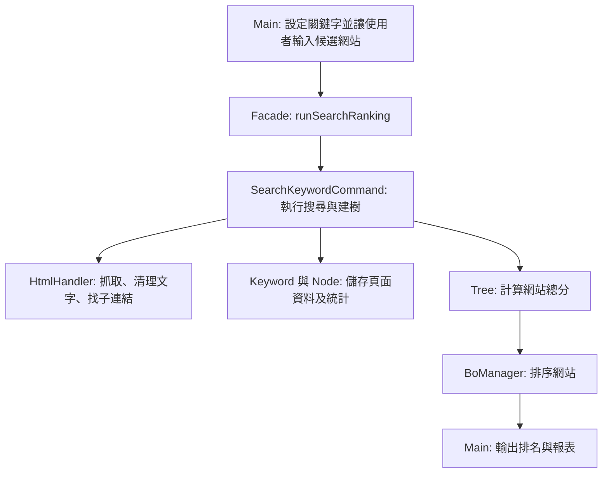

# Smart Ranking Engine 專案進度與程式說明

## 專案目標

輸入候選網站及關鍵字權重，抓取網站頁面內容，計算各頁面的關鍵字分數，再依網站總分由高至低排序，最後輸出排名與頁面關鍵字統計。

## 程式架構



## 各 Class 職責

| Class | Package | 職責 |
| --- | --- | --- |
| `Keyword` | `smartranking.model` | 保存關鍵字名稱、權重及頁面出現次數；單一關鍵字分數為「出現次數 × 權重」。 |
| `Node` | `smartranking.model` | 表示一個網頁，保存名稱、URL、關鍵字統計和子頁面。每個 Node 會複製一份 Keyword，避免不同網頁共用次數。 |
| `Tree` | `smartranking.model` | 表示一個候選網站及其頁面樹；計算網站總分、展平頁面清單，並依總分提供降冪比較。 |
| `HtmlHandler` | `smartranking.util` | 發送 HTTP GET、將 HTML 轉成文字、計算關鍵字出現次數，以及擷取最多指定數量的同站連結。 |
| `ICommand` | `smartranking.command` | 命令模式介面，規定命令實作 `execute()`。 |
| `SearchKeywordCommand` | `smartranking.command` | 主要流程控制器：清空舊結果、逐站抓頁、統計關鍵字、建立 Tree，最後呼叫 Manager 排名。 |
| `BoManager` | `smartranking.manager` | 管理網站 Tree 清單，計算總分並依分數降冪排序。 |
| `Facade` | `smartranking.facade` | 提供單一入口 `runSearchRanking()`，內部建立並執行搜尋命令；以 Singleton 方式提供共用實例。 |
| `Main` | `smartranking` | 設定關鍵字與權重，讓使用者輸入候選網站 URL，呼叫 Facade，並印出排名和各頁面統計。 |

## 執行流程

1. `Main` 建立關鍵字規則，並讓使用者逐行輸入候選網站 URL；輸入空行後開始分析。
2. `Main` 呼叫 `Facade.runSearchRanking()`。
3. Facade 建立 `SearchKeywordCommand` 並呼叫 `execute()`。
4. Command 清空 Manager 舊資料，對每個網站抓取根頁 HTML。
5. `HtmlHandler` 清理 HTML 後，Command 逐一計算關鍵字次數，並從根頁最多取兩個同站連結建立子 Node。
6. Command 將根 Node 與子 Node 組成 Tree，加入 `BoManager`。
7. Manager 呼叫每個 Tree 計算總分，按分數由高至低排序。
8. 結果回到 Main，列印網站總分、頁面 URL、單頁分數及關鍵字統計。

## 計分邏輯

單一關鍵字的頁面分數：

```text
關鍵字分數 = 出現次數 × 關鍵字權重
頁面分數 = 該頁所有關鍵字分數總和
```

網站總分以根頁為基準，子頁每往下一層乘以 `0.5` 衰減：

```text
網站總分 = 根頁分數 + Σ(子樹分數 × 0.5)
```

因此目前直接子頁貢獻一半分數；若未來建立更深層的頁面樹，每多一層會再乘一次 `0.5`。`Tree.compareTo()` 讓分數高的網站排在前面。
